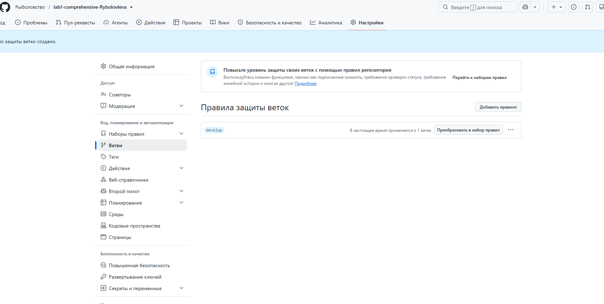
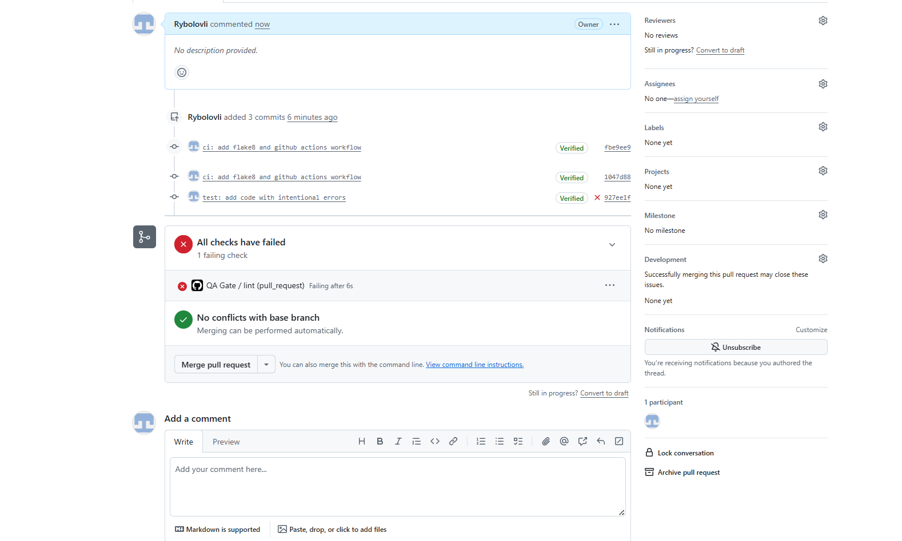
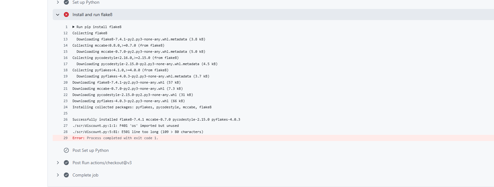
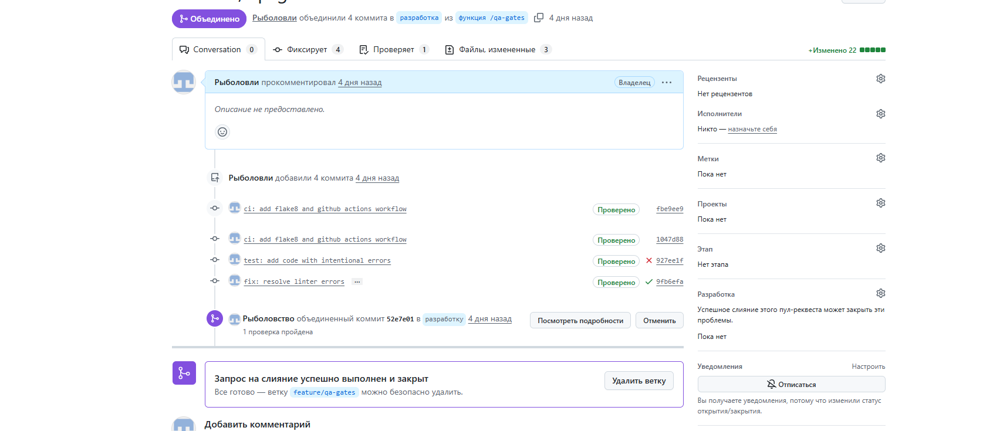

# Итоговый аналитический отчет (Лабораторная работа №1)

Автор: Рыболовлева Александра
Дисциплина: Моделирование и анализ программного обеспечения
Формат: Индивидуальная самостоятельная работа в браузере (Cloud-Native)
Продолжительность: 120 минут
Репозиторий: https://github.com/Rybolovli/lab1-comprehensive-Rybolovleva

## 1. Резюме (Executive Summary)

Цель работы: подготовить процесс разработки микросервиса «Расчет корзины и скидок» для системы лояльности. В рамках работы я сравнила две СУБД (PostgreSQL и MongoDB) методом взвешенной матрицы решений, настроила репозиторий с моделью ветвления и защитой базовой ветки, подключила автоматическую проверку кода (flake8 через GitHub Actions), построила диаграмму деятельности для legacy-функции расчета стоимости корзины и подготовила план code-review.

Основные результаты:
- выбрана СУБД PostgreSQL (взвешенная оценка 4.45 против 3.40 у MongoDB);
- настроены ветки main, develop и feature/*, защита develop, CODEOWNERS и .editorconfig;
- проверка качества работает: ошибки линтера блокируют «зеленый» статус, после исправления проверка проходит;
- подготовлены UML-диаграмма и план ревью модуля src/discount.py.

## 2. Сравнительный анализ технологий

### 2.1. Матрица принятия решений

Контекст: СУБД нужна для хранения истории транзакций, баллов и промокодов, то есть для финансовых данных, где важны точность и целостность. Матрица составлена и рассчитана в Microsoft Excel (файл [decision_matrix.xlsx](decision_matrix.xlsx)). Баллы выставлены по 5-балльной шкале (от 1 до 5).

Критерии, их веса и баллы кандидатов (формат: критерий, вес, балл PostgreSQL, балл MongoDB):

1. Поддержка ACID-транзакций: вес 0.35, PostgreSQL 5, MongoDB 3.
2. Целостность данных (строгая схема, связи): вес 0.20, PostgreSQL 5, MongoDB 3.
3. Производительность чтения: вес 0.20, PostgreSQL 4, MongoDB 4.
4. Гибкость схемы: вес 0.10, PostgreSQL 3, MongoDB 5.
5. Стоимость владения и экосистема: вес 0.15, PostgreSQL 4, MongoDB 3.

Сумма весов: 0.35 + 0.20 + 0.20 + 0.10 + 0.15 = 1.00.

Обоснование весов:
- ACID получил максимальный вес 0.35: начисление и списание баллов должно выполняться целиком или не выполняться совсем, иначе возможны потери и дублирование баллов;
- целостность данных и производительность чтения получили по 0.20: важны связи между клиентом, транзакциями и промокодами, а расчет корзины должен выполняться быстро;
- гибкость схемы получила небольшой вес 0.10, так как структура данных транзакций стабильна;
- стоимость владения и экосистема получили 0.15: обе СУБД доступны бесплатно, но у PostgreSQL более зрелая экосистема инструментов для финансовых систем.

Скриншот таблицы из Excel:

### 2.2. Расчет и обоснование выбора

Формула: Оценка = Сумма (Вес_критерия * Балл_кандидата).

PostgreSQL:
0.35*5 + 0.20*5 + 0.20*4 + 0.10*3 + 0.15*4 = 1.75 + 1.00 + 0.80 + 0.30 + 0.60 = **4.45**

MongoDB:
0.35*3 + 0.20*3 + 0.20*4 + 0.10*5 + 0.15*3 = 1.05 + 0.60 + 0.80 + 0.50 + 0.45 = **3.40**

Вывод: для микросервиса выбрана **PostgreSQL**. MongoDB выигрывает только по гибкости схемы, но для финансовых данных этот критерий менее важен, чем транзакционность и целостность.

## 3. Архитектура и контроль версий

### 3.1. Настройка репозитория

Репозиторий публичный: https://github.com/Rybolovli/lab1-comprehensive-Rybolovleva

Модель ветвления:
- main: стабильная ветка с README.md;
- develop: ветка интеграции, создана от main;
- feature/infrastructure, feature/qa-gates, feature/review-plan, feature/report: отдельные ветки под задачи, создавались от develop и вливались через Pull Request.

Pull Request с инфраструктурой: https://github.com/Rybolovli/lab1-comprehensive-Rybolovleva/pull/1

История коммитов: https://github.com/Rybolovli/lab1-comprehensive-Rybolovleva/commits/develop

### 3.2. Контроль доступа

Для ветки develop создано правило защиты (Branch protection rule) с включенным требованием Pull Request перед слиянием, поэтому прямые коммиты в develop невозможны. Обязательное одобрение (approval) не включалось: автор не может одобрить собственный Pull Request, а работа выполняется индивидуально.

Файл .github/CODEOWNERS:

`* @Rybolovli`

Также добавлен файл .editorconfig (кодировка UTF-8, отступы 4 пробела, переносы строк LF).

## 4. Инструментальный контроль качества

### 4.1. Настройка CI/CD

Добавлены конфигурация линтера [.flake8](https://github.com/Rybolovli/lab1-comprehensive-Rybolovleva/blob/develop/.flake8) (максимальная длина строки 80 символов) и workflow [.github/workflows/qa.yml](https://github.com/Rybolovli/lab1-comprehensive-Rybolovleva/blob/develop/.github/workflows/qa.yml). Workflow запускается при создании Pull Request в ветку develop, устанавливает flake8 и проверяет весь репозиторий.

### 4.2. Работа Quality Gate

Методом «сломать и починить» проверена работа проверки качества. Pull Request: https://github.com/Rybolovli/lab1-comprehensive-Rybolovleva/pull/2

Шаг 1. В файл src/discount.py намеренно добавлены неиспользуемый импорт os и строка длиннее 80 символов. После создания Pull Request проверка QA Gate завершилась с ошибкой:

Текст ошибок линтера:

- ./scr/discount.py:1:1: F401 'os' imported but unused
- ./scr/discount.py:5:81: E501 line too long (109 > 80 characters)

Шаг 2. Исправление (коммит «fix: resolve linter errors»): удален неиспользуемый импорт os, длинный комментарий в строке 5 убран. Заодно исправлено название папки (в логе видно scr, нужно src). После этого проверка прошла успешно:

Вывод: Quality Gate блокирует код с нарушениями стиля до слияния, а исправление автоматически перезапускает проверку.

## 5. Обратное проектирование и планирование ревью

### 5.1. Анализ алгоритма

Функция calculate_cart_total считает итоговую стоимость корзины: сначала применяется базовая скидка 15% для корзин дороже 15000, затем в цикле обрабатываются промокоды (SUMMER снижает цену на 500, VIP дает скидку 10%), затем скидка по уровню лояльности (уровень 1: 3%, уровень 2: 7%), и в конце цена ограничивается нижней границей: итог не может быть ниже 70% от исходной суммы корзины.

Диаграмма деятельности (draw.io): на ней показаны начальный и конечный узлы, условие базовой скидки, цикл по промокодам с вложенными условиями и финальное ограничение скидки.

Файл диаграммы: [docs/uml_diagram.png]()

Выявленные «запахи кода» (Code Smells):
1. Магические числа: 15000, 0.85, 500, 0.90, 0.97, 0.93, 0.70 записаны прямо в коде без пояснений.
2. Строковые литералы: коды промокодов "SUMMER" и "VIP" и номера уровней 1 и 2 зашиты в условия.
3. Цепочки if/elif: добавление нового промокода или уровня требует правки кода, лучше хранить скидки в словаре.
4. Нет валидации входных данных: отрицательная сумма, неизвестный уровень, promos равен None приводят к ошибке или неверному результату.
5. Деньги в float: возможны ошибки округления, для денежных сумм лучше Decimal.
6. Многократная перезапись price: порядок применения скидок неявный, результат зависит от порядка промокодов.
7. Нет документации, подсказок типов и тестов.
8. Лишние пробелы в конце строк: нарушения стиля, линтер выдаст W291.

### 5.2. План code-review

Подход: сначала автоматическая проверка линтером (flake8 без замечаний), затем ручное ревью логики расчетов, защиты от фрода и тестов. План оформлен в файле docs/review-plan.md.

Pull Request с планом ревью (оставлен открытым, не слит): https://github.com/Rybolovli/lab1-comprehensive-Rybolovleva/pull/3

Ключевые измеримые критерии:
- отсутствие магических чисел (все пороги и коэффициенты в именованных константах);
- валидация всех входных параметров (cart_sum, tier, promos);
- покрытие тестами более 80%;
- 0 замечаний flake8.

Участники и роли: автор кода (Tech Lead), ревьюер-разработчик, QA-инженер, модератор.

Эскалация при спорах: обсуждение автора и ревьюера в комментариях (не более 2 итераций), затем подключается модератор; если спор не решен за 1 рабочий день, решение принимает руководитель проекта и фиксирует его в комментарии к Pull Request.

## 6. Заключение

Настроенные процессы снижают риск внесения дефектов на нескольких уровнях. Защита ветки develop и обязательный Pull Request не дают попасть в основную ветку непроверенному коду. Автоматический линтер в GitHub Actions выявляет типичные ошибки (неиспользуемые импорты, нарушения стиля) до слияния, что подтверждено экспериментом «сломать и починить». CODEOWNERS и .editorconfig закрепляют ответственность и единые стандарты оформления. План ревью с измеримыми критериями и порядком эскалации делает проверку критичного модуля расчета скидок воспроизводимой. Выбор PostgreSQL с поддержкой ACID защищает от потери и дублирования баллов и транзакций.
